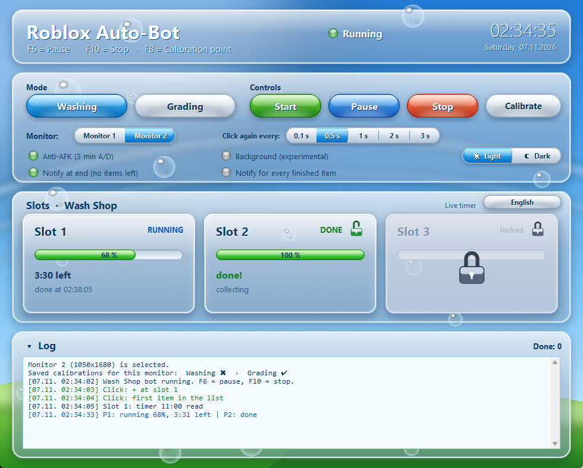
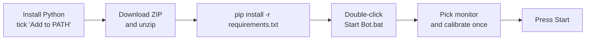
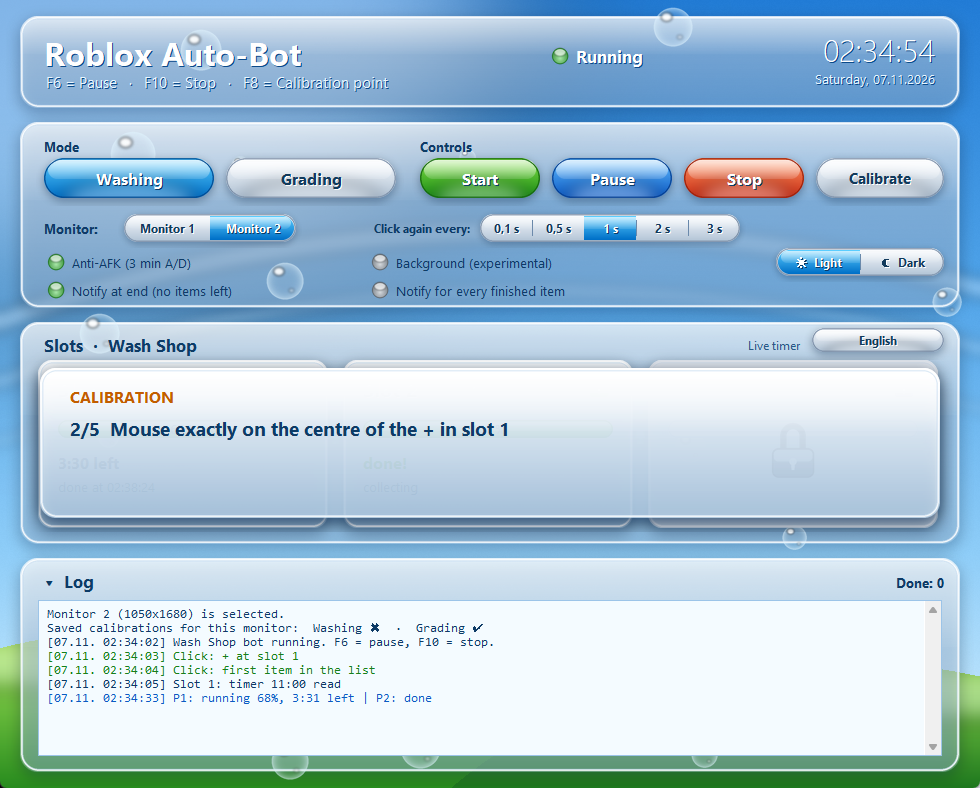
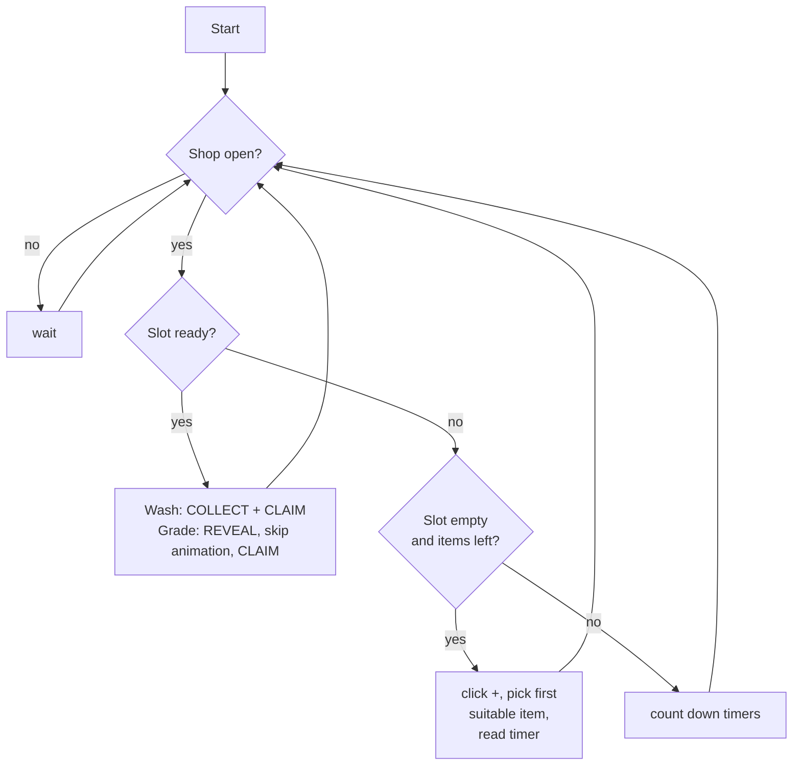
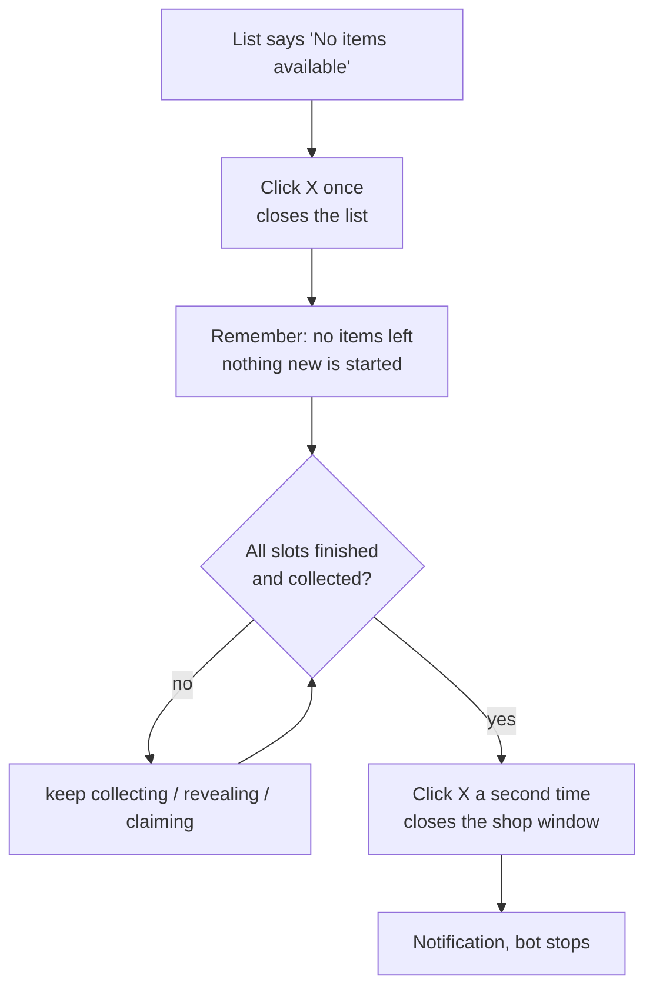

# Roblox Auto-Bot — Wash Shop & Grading Shop

A small Windows tool that keeps the **Wash Shop** and the **Grading Shop** in *Storage Hunters: Open World* running by itself: it fills empty slots, waits for the timers, collects the result and starts over.

It only **looks at your screen and clicks** (like you would). It does not touch Roblox or the game files.



> ## ⚠️ Read this first
> - **Use at your own risk.** Automating clicks may be against the rules of the game or of Roblox. Check the game's rules / Discord before you use it. If automation is not allowed, don't use it.
> - This project is a hobby tool. It is **not affiliated with Roblox or the game's developers.**
> - It was built and tested on one setup (Windows 11, 1 or 2 monitors). Things can differ on yours — see [Troubleshooting](#troubleshooting).

---

## What it does

| | Wash Shop | Grading Shop |
|---|---|---|
| Fills empty slots | ✔ first suitable item | ✔ first item that is **not `[Broken]`** |
| Waits for the timer | ✔ reads it once, then counts down live | ✔ same |
| When a slot is ready | clicks **COLLECT**, then **CLAIM** | clicks **REVEAL**, skips the animation, clicks **CLAIM** |
| Slots used | only slot 1 by default — [open the padlocks](#slot-locks) of the slots you have | same |

Extra features
- Finds the item cards **automatically** (4, 3, 2 or 1 per row) — you don't calibrate item positions.
- Skips items marked **`[Broken]`**, in **20 languages** (it reads the red tag; other tags like `[Exclusive]` are taken).
- When there are **no items left**, it closes the list, lets the running slots finish, then closes the window, stops and (optionally) shows a **Windows notification**.
- Live countdown per slot, anti-AFK option, light/dark theme, resizable window with collapsible log.
- Remembers your settings and a **separate calibration per monitor and per mode**.

**It never clicks** the gold **re-roll** button (costs Robux), **Skip** or **Unlock** buttons. If a click would land on the gold button it is cancelled.

---

## Installation (5 minutes)

You need **Windows 10 or 11** and **Python 3.11 or newer**.

1. **Install Python** from <https://www.python.org/downloads/>.
   During setup tick **"Add python.exe to PATH"**.
2. **Download this repository** (green *Code* button → *Download ZIP*) and unzip it somewhere, e.g. `C:\RobloxBot`.
3. Open the folder, click into the address bar, type `cmd`, press Enter, then run:
   ```
   pip install -r requirements.txt
   ```
4. **Start the bot** by double-clicking **`Start Bot.bat`**.

That's it. The window from the screenshot above opens.



---

## How to use it

### 1. Choose your monitor (required)
In the row **Monitor**, click the monitor where Roblox is running. The choice is saved.

### 2. Choose the mode
**Washing** or **Grading**. You can't switch while the bot is running.

### 3. Calibrate once (per monitor and mode)
Open the shop in Roblox (slots 1 and 2 must be **empty**, showing the **+**), then press **Calibrate**. The banner tells you what to do — you point the mouse at 5 things and press **F8** each time:



| Step | Point the mouse at … | Then |
|---|---|---|
| 1/5 | the first word of the shop title | **F8** |
| 2/5 | the centre of the **+** in slot 1 | **F8** |
| 3/5 | the centre of the **+** in slot 2 | **F8** |
| — | click the **+** in slot 1 yourself so the item list opens | |
| 4/5 | the first word of the item-list title | **F8** |
| 5/5 | the **X** at the top right of the list | **F8** |

Afterwards close the item list with the X. The log tells you if something looked wrong (warnings start with `!!`). **F10** cancels.
You only do this once per monitor and mode — it's remembered.

### 4. Press Start
The bot now runs by itself. Keep Roblox visible (not covered by other windows).

| Control | What it does |
|---|---|
| **Start / Pause / Stop** | run, pause (**F6**), stop (**F10**) |
| **Click again every** | how often the bot clicks again if the game didn't react (0.1 – 3 s). It gives up with an error after 30 s |
| **Anti-AFK** | presses A/D a few times every 3 minutes |
| **Background (experimental)** | sends clicks to Roblox without moving your mouse — doesn't work in every game, leave it off if unsure |
| **Notify at end** | Windows notification when there are no items left and the bot stopped |
| **Notify for every finished item** | Windows notification after every finished item |
| **Light / Dark** | theme |
| **Language button** | interface language. **Set it to the same language as Roblox** — the `[Broken]` detection needs it |

**Emergency stop:** press **F10**, or move the mouse to the **top-left corner** of the screen.

### Slot locks

Slot 2 and slot 3 have a small **padlock** in the top-right corner of their card (slot 1 doesn't — it is always used).

| Icon | Meaning |
|---|---|
|  **closed, card greyed out** | the bot **ignores** this slot (it never clicks it, never waits for it) |
|  **open** | the bot **uses** this slot |

- **Set it up for your own account:** how many slots you have differs from player to player. Open or close the padlocks so they match **exactly the slots you have unlocked in the game** — one, two or all three. The bot only uses the open ones.
- **Default:** in both modes **only slot 1 is open**, slots 2 and 3 are locked. Open the padlocks of the slots you have unlocked in the game. (The screenshots above show slot 2 opened as an example.)
- **Change it** by clicking the padlock. This only works when **the bot is paused or stopped** *and* **that slot isn't in use** (no running timer, nothing waiting to be collected). Otherwise the log tells you why.
- Your choice is saved **per mode**.
- The bot does **not** unlock slots in the game (that may cost real money). Only open the padlock for slots that are really **unlocked in the game** — otherwise the bot waits for a slot that never works.

---

## What the bot does (simplified)



### When there are no items left



If you stop and restart the bot, it forgets "no items left" and checks again. Pause keeps it.

---

## Troubleshooting

### The window doesn't open / nothing happens when I double-click `Start Bot.bat`
`Start Bot.bat` hides error messages. Find out what's wrong:
1. Open the folder, click the address bar, type `cmd`, Enter.
2. Run `python aero_ui.py` and read the error.

Common causes:
- **`'python' is not recognized`** → Python is not installed or "Add to PATH" was not ticked. Reinstall Python and tick it.
- **`No module named 'numpy'` / `'PIL'`** → run `pip install -r requirements.txt`.
- **A message says the bot is already open** → another copy is running. Open Task Manager and end all `pythonw.exe` / `python.exe` processes, then start again. (Only one copy may run, otherwise two bots would click at once.)

### I pressed Start but it says to choose a monitor / calibrate
Pick your monitor first (row *Monitor*). Then press **Calibrate**. The log line *"Saved calibrations for this monitor"* shows which modes already have a calibration (✔) and which don't (✖).

### It clicks in the wrong place
- You picked the **wrong monitor** — pick the one with Roblox and calibrate again.
- You **moved or resized the Roblox window** after calibrating → calibrate again.
- Calibrate again and point **exactly** at the first word of the title and the centre of the **+**.
- Roblox must be **visible** — not minimized, not covered by another window.

### Calibration shows warnings (`!! …`)
- *"The + of slot N was not recognised"* → the slot was not empty, or the + wasn't visible. Empty both slots and calibrate again.
- *"Item list and shop cannot be told apart"* → in steps 1 and 4 point at the **first word of the title**, not at the border.
- *"No item cards were recognised"* → the item list wasn't open at step 4, or the title / X point was wrong.

### The timer isn't read ("timer not readable")
The timer is read with the **text recognition built into Windows**. Make sure Windows has the language pack of your Roblox language: *Settings → Time & language → Language & region → Add a language*. Also make sure the timer isn't hidden behind another window.

### Good items are skipped / `[Broken]` items are taken
Set the bot's **language** (button at the top right of the slots panel) to **the same language as Roblox**. Unreadable tags are treated as `[Broken]` on purpose (the bot skips them).

### I unlocked slot 3 in the game but the bot doesn't use it
Open the padlock on the slot-3 card (see [Slot locks](#slot-locks)). Pause or stop the bot first.

### The padlock doesn't react
The log says why: either the bot is running (press **Pause** or **Stop** first) or the slot is still in use (wait until its item is finished and collected).

### The bot waits forever for a slot
You opened the padlock of a slot that is **not** unlocked in the game. Pause the bot and close that padlock again.

### The bot clicks something else than the item (e.g. the bottom bar)
Calibrate again, especially steps **4 and 5**. The item cards are found automatically, so this usually means the list title / X point is off.

### "Click again" keeps repeating and then gives up after 30 s
Roblox didn't react to the click. The shop might have closed, or the game lags. Increase *Click again every* (e.g. 2 s), check that Roblox is in front, and press Start again.

### Background mode doesn't work
That mode is experimental — turn it off (the bot then uses your real mouse).

### I don't get Windows notifications
- Check **Windows Focus Assist / Do Not Disturb**.
- The notification appears under the name **"Windows PowerShell"**.
- Make sure the toggles *Notify at end* / *Notify for every finished item* are on (the green ball).

### Reset everything
Close the bot and delete these (they are re-created): `einstellungen.json` (settings), the `kalibrierungen` folders inside `waschen` and `werten` (calibrations), and `bot.log` files.

---

## Files

| File | What |
|---|---|
| `aero_ui.py` | the window (start this) |
| `waschen/waschbot.py` | Wash Shop bot (`waschen` = washing) |
| `werten/wertbot.py` | Grading Shop bot (`werten` = grading) |
| `hilfen.py` | item-card detection, "no items" detection, notifications |
| `sprachen.py`, `meldungen.py` | the 20 languages (interface texts, `[Broken]` words, log messages) |
| `ocr.ps1` | reads timers with Windows OCR |

Code comments are partly in German. You can also run a bot without the window: `python waschen/waschbot.py` (options: `--calibrate`, `--anti-afk`, `--monitor N`, `--sprache xx`).

## Disclaimer
Provided as is, without warranty. You are responsible for how you use it.
